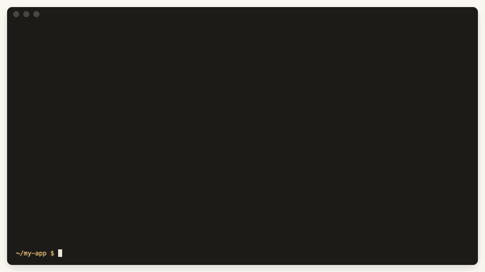

<p align="center"></p>

<h1 align="center">Harness Guard</h1>

<p align="center">Check your agent's whole harness before you trust it.</p>

<p align="center">
  <a href="https://github.com/SamBagetAI/harness-guard/actions/workflows/checks.yml"></a>
  <a href="LICENSE"></a>
  
  
  
  
</p>



Your agent runs with more than its prompt: hooks that fire on every message, MCP servers that start
with every session, plugins that update themselves, skills you downloaded. Harness Guard reads all of
it, without running any of it, and tells you what it does without asking you.

- **Permissions, not a score.** The commands that run on their own, the servers it starts, the sites
  it contacts, the secrets it reads.
- **A verdict per piece.** ✅ OK, ⚠️ NEEDS REVIEW or ⛔ BLOCKED, with the line behind it.
- **Blocks only what is serious**, like `curl | sh`, a secret read next to a network call, or a
  crypto miner. The rest is for you to decide.
- **An AI judge on top** that must quote its evidence. It can never clear a block.
- **Approve once, then see only changes**: a plugin update or a package moved to `@latest` shows up
  on its own.

## Try it

```bash
npm install -g github:SamBagetAI/harness-guard
harness-guard install
```

`install` adds three Claude Code hooks and the MCP server, for every project (`uninstall` takes
them out). Needs Node 18 or later.

| When | You | Harness Guard |
|---|---|---|
| You open a project | `harness-guard` | Shows what the harness does and each piece's verdict. |
| You have read it | `harness-guard approve` | From now on, reports only what changes. |
| You find a new skill | `harness-guard ./the-skill` | Gives its verdict before you install it. |
| A session starts | nothing | Claude tells you if something is blocked or changed. |
| You ask Claude | "Check my harness" | Claude shows you the report. |
| In CI | `harness-guard ./skills/x --json --no-judge` | Exits `0` OK, `1` review, `2` blocked. |

## How well it works

On 136 real skills (70 from Anthropic, OpenAI, obra/superpowers and Vercel, 66 malicious ones from
[MalSkillBench](https://github.com/lxyeternal/MalSkillBench)), on the half the rules were not tuned on:

| | Malicious caught | Safe ones flagged |
|---|---|---|
| Static analysis | 67 % | 14.3 % |
| With the AI judge | **97 %** | **5.7 %** |

## More

- [How it works](docs/how-it-works.md): the rules, the judge, the measurements and what it cannot see.
- [Examples](examples): defanged skills and a whole harness, each with its expected verdict
  (`npm run examples`).
- [Contributing](CONTRIBUTING.md) and [security](SECURITY.md).

MIT license.
